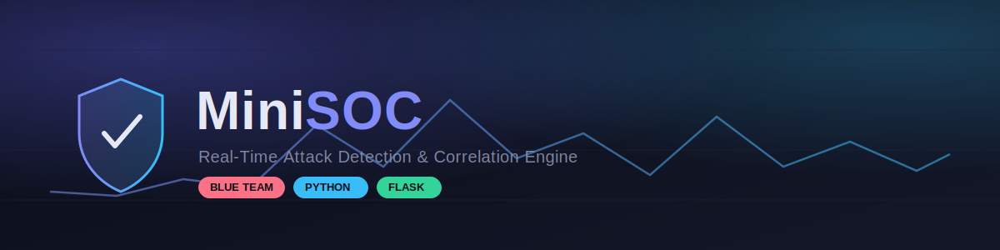
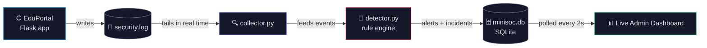

<p align="center">
  
</p>

<p align="center">
  
  
  
  
  
</p>

<p align="center">
  A lightweight, from-scratch <b>Security Operations Center</b> — it watches a live web app,
  detects attacks in real time, correlates them into incidents, and streams everything to a live dashboard.
</p>

---

## 📑 Table of Contents

- [🛡️ Overview](#️-overview)
- [⚙️ Architecture](#️-architecture)
- [🎯 Detected Attacks](#-detected-attacks)
- [🧰 Tech Stack](#-tech-stack)
- [🚀 Getting Started](#-getting-started)
- [📁 Project Structure](#-project-structure)
- [📸 Live Dashboard](#-live-dashboard)
- [⚠️ Known Limitations](#️-known-limitations)
- [🧠 Why I Built This](#-why-i-built-this)

---

## 🛡️ Overview

**MiniSOC** is built around **EduPortal**, a small student-portal web app. Every security-relevant
action — logins, failed logins, profile updates, document access, resource requests — is logged.
A background collector tails that log in real time, runs each event through a custom rule-based
detection engine, and writes alerts straight into a live-updating admin dashboard.

> 🧪 Tested end-to-end against real offensive tooling from a **Kali Linux** attacker machine —
> Hydra for brute-forcing, curl-crafted payloads for injection and exploitation — to confirm every
> rule actually fires against a live attack, not just in theory.

---

## ⚙️ Architecture



| Component | Role |
|---|---|
| 🌐 `eduportal/` | The monitored web app — logs every security-relevant event |
| 🔍 `minisoc/collector.py` | Tails `security.log` live and parses each event |
| 🧠 `minisoc/detector.py` | Rule-based detection engine + multi-stage correlation |
| 🗄️ `minisoc/storage.py` | SQLite persistence for alerts, incidents, incident rules |
| 📊 Admin dashboard | Live-polling UI with charts, severity coding, threat gauge |

---

## 🎯 Detected Attacks

| # | Rule | Severity | Trigger |
|---|---|:---:|---|
| 🔑 | `BRUTE_FORCE` | 🔴 HIGH | 5+ failed logins from one IP within 60s |
| 🕵️ | `ACCOUNT_ENUMERATION` | 🔴 HIGH | 5+ different emails failing login from one IP within 60s |
| 💉 | `SQLI_DETECTED` | 🔴 HIGH | SQL injection patterns in the login email field |
| 🧬 | `XSS_DETECTED` | 🔴 HIGH | XSS payloads in profile update fields |
| 📂 | `PATH_TRAVERSAL` | 🔴 HIGH | Directory traversal sequences in resource requests |
| 🔓 | `UNAUTHORIZED_DOCUMENT_ACCESS` | 🔴 HIGH | IDOR — accessing a document not owned by the user |
| 📡 | `ENDPOINT_PROBING` | 🟡 MEDIUM | 8+ different endpoints hit from one IP within 60s |
| 🧩 | `CORRELATED_ATTACK` | 🔴 HIGH | 2+ different rule types from one IP within a 5-minute window — opens/updates an incident automatically |

---

## 🧰 Tech Stack

<p>
  
  
  
  
  
</p>

---

## 🚀 Getting Started

```bash
git clone https://github.com/Fedi-Mhadhbi/MiniSOC.git
cd MiniSOC

python3 -m venv venv
source venv/bin/activate
pip install -r requirements.txt

# Generate and export a real secret key (don't use the dev fallback outside local testing)
export SECRET_KEY="$(python3 -c 'import secrets; print(secrets.token_hex(32))')"

python -m minisoc.storage   # creates minisoc.db
./run.sh                    # starts the app + the collector together
```

Then open **`http://localhost:5000/minisoc`** after registering and logging in as an admin.

---

## 📁 Project Structure

```
MiniSOC/
├── run.sh
├── requirements.txt
├── eduportal/
│   ├── app.py
│   ├── templates/
│   └── static/
└── minisoc/
    ├── collector.py
    ├── detector.py
    ├── storage.py
    └── minisoc.db          (git-ignored, created at runtime)
```

---

## 📸 Live Dashboard

**Overview** — live threat gauge, activity trend, severity breakdown, and the top-attacking-IPs
leaderboard, all updating every 2 seconds without a page refresh.


**Correlated alerts in action** — a single attacker IP triggering `ACCOUNT_ENUMERATION`,
`SQLI_DETECTED`, `XSS_DETECTED`, `PATH_TRAVERSAL`, `UNAUTHORIZED_DOCUMENT_ACCESS`, and
`BRUTE_FORCE` gets automatically folded into one `CORRELATED_ATTACK` incident instead of six
disconnected alerts.


---

## ⚠️ Known Limitations

- Detection state (failed-login counts, active incidents, etc.) lives **in memory** inside the
  collector process. Restarting it resets that state.
- Incidents are **not automatically closed** if traffic for an IP simply stops before the
  5-minute correlation window elapses — they stay `OPEN` until a sweep or manual review.
- Detection rules are intentionally simple (regex/threshold-based) rather than statistical or
  ML-based anomaly detection — this is a learning project, not a production SIEM.

---

## 🧠 Why I Built This

To understand detection engineering from the ground up — writing the rules myself instead of
configuring an existing SIEM, then validating the system by attacking it with real offensive
tooling from a separate Kali Linux machine. This project forced me to think like both the
attacker crafting the payload and the defender trying to catch it.

<p align="center">
  <sub>Built by <a href="https://github.com/Fedi-Mhadhbi">Fedi Mhadhbi</a> — feedback and issues welcome.</sub>
</p>
